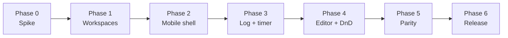

# Lift Tracker — Web + Mobile Build Plan

_As of 2026-09-22._ Companion to [BUILD_PLAN.md](BUILD_PLAN.md), which covers the web PWA. This
document covers the move to a `web` / `mobile` / shared monorepo and the native mobile app.

**How to use this document:** same rule as BUILD_PLAN.md. Hand Claude one phase at a time. Each
phase leaves web deployable and the root gates green.

---

## 0. Decisions made (2026-09-22)

- [x] **Option B**: monorepo with `web`, `mobile` and shared packages. Web stays the Vite PWA.
      Mobile is a new Expo app with a native UI. No Capacitor detour.
- [x] **Firebase SDK on mobile** (2026-09-28): `@react-native-firebase`. The JS SDK's Firestore
      cache is memory only on React Native, so a queued write dies with the app. The native SDKs
      persist to disk by default. Decided from documentation, not from an iPhone test. See Phase 0.
- [x] **Package manager**: pnpm workspaces.
- [x] **First release**: iOS and Android together. React Native carries nearly everything; expect a
      couple of small native implementations behind the platform adapter.
- [x] **Web → store hand-off**: not a redirect. The web app cannot tell whether the native app is
      installed, and React Native cannot answer that for a web page either. Use what the OS provides:
  - iOS Safari: the `apple-itunes-app` meta tag shows the Smart App Banner. Safari knows whether the
    app is installed and shows "Open" or "View".
  - Android Chrome: `related_applications` with the Play package id and
    `prefer_related_applications: true` in the web manifest. Chrome then offers the native app
    instead of installing the PWA.
  - Share links: universal links (iOS) and app links (Android) open the app when installed and fall
    back to the web page when not. Nothing in the page has to check.

---

## 1. Where the app stands today

The repo is already split the way a shared-code project needs. About 13,200 lines of pure
TypeScript sit in `src/domain/` with no React and no Firebase imports. That code moves to mobile
as-is. The UI (`src/features/`, ~14,300 lines, plus `src/app/`, ~1,400 lines) is written against
Mantine in 66 files. That code does not move to mobile.

| Layer                                                           | Lines       | Depends on                      | Portable to React Native?      |
| --------------------------------------------------------------- | ----------- | ------------------------------- | ------------------------------ |
| `src/domain/` (overlay, strength, volume, diff, sharing, tests) | ~13,200     | nothing                         | Yes, unchanged                 |
| `src/catalog/` (bundled exercise data + search index)           | ~400 + JSON | nothing                         | Yes, unchanged                 |
| `src/data/` (Firebase converters, hooks, mutations)             | ~3,800      | Firebase JS SDK, React          | Mostly, behind a small adapter |
| `src/features/` (screens)                                       | ~14,300     | Mantine, dnd-kit, CSS modules   | No, rewrite per screen         |
| `src/app/` (router, PWA shell, service worker)                  | ~1,400      | Vite PWA, Workbox, react-router | No, web only                   |

The web app already has a rest timer, a service-worker notification and dnd-kit reordering. The
limits are the browser's, not the code's:

- **Rest timer and clock.** iOS suspends a backgrounded tab's JavaScript. The service worker in
  `src/sw.ts` is a best-effort workaround, and it only fires if the PWA is installed.
- **Notifications.** iOS delivers web push only to an installed PWA. Sticky, repeating and
  action-button behavior is inconsistent across browsers.
- **Drag and drop.** dnd-kit fights the browser's scroll and long-press gestures on touch. There is
  no haptic feedback and no native reorder animation.

Everything else (offline logging, overlays, sharing, PR tracking, schedule) works today and must
keep working on web through the change.

---

## 2. The options compared

|                            | A. Port everything to React Native (Expo + react-native-web)                                                    | B. Monorepo: web / mobile / shared                 | C. Wrap the PWA with Capacitor                        |
| -------------------------- | --------------------------------------------------------------------------------------------------------------- | -------------------------------------------------- | ----------------------------------------------------- |
| Web app                    | Rewritten in RN primitives, served through react-native-web                                                     | Untouched; current Vite PWA keeps shipping         | Untouched                                             |
| Mobile app                 | Native iOS/Android from the same code                                                                           | New Expo app, native UI                            | Current web UI inside a native shell                  |
| Code reused                | `domain`, `catalog`, most of `data`                                                                             | `domain`, `catalog`, most of `data`                | 100%                                                  |
| Code thrown away           | All ~15,700 lines of Mantine UI and PWA shell                                                                   | None                                               | None                                                  |
| Code written               | One new UI (all screens, once)                                                                                  | One new UI (all screens, once)                     | Plugin glue: timer, notifications, haptics            |
| Rest timer / notifications | Native                                                                                                          | Native                                             | Native (background task + local notification plugins) |
| Drag and drop              | Native gesture handler on mobile; same on web, feels less web-like                                              | Native on mobile, dnd-kit stays on web             | Still dnd-kit in a WebView; no improvement            |
| Web performance            | Worse. react-native-web ships a large runtime; Mantine, CSS modules, Workbox and the Lighthouse budgets go away | Same as today                                      | Same as today                                         |
| Look and feel              | One UI on both. Web looks like a mobile app                                                                     | Two UIs. Each matches its platform                 | One UI, web-styled                                    |
| Store presence             | Yes                                                                                                             | Yes                                                | Yes, but Apple can reject thin WebView apps           |
| Ongoing cost               | One codebase, one UI                                                                                            | Two UIs to keep in step; shared logic changes once | Lowest                                                |
| Rough effort               | Largest: rebuild web and mobile at once                                                                         | Large: build mobile only                           | Smallest: days to a couple of weeks                   |

Option A does not save the UI work. Mantine has no React Native version, so every screen is
rewritten either way. Option A also makes you rewrite and re-tune the web app you already have, and
accept a slower one.

Option C solves timer, clock and notifications but not drag and drop, and adds an App Store review
risk. Rejected on 2026-09-22 in favor of going straight to B.

---

## 3. Recommendation (adopted)

Option B: a monorepo with `web`, `mobile` and shared packages. Keep the PWA as the web app. Build
the mobile app in Expo.

1. **The UI rewrite is the same size under A and B.** Option A adds a web rewrite and a slower web
   app on top. Speed is the stated top priority for this app.
2. **The shared code already exists.** The BUILD_PLAN ground rules kept `domain` pure and Firebase
   confined to `data`. Option B is mostly moving folders, not refactoring.
3. **Different UIs is a feature here.** A gym app on a phone wants big touch targets, swipe
   gestures, haptics and a lock-screen timer. A web app wants keyboard entry and dense tables for
   reviewing history.
4. **Nothing breaks while you build.** Web keeps deploying from day one. The mobile app can ship at
   30% parity (log a workout, rest timer) and still be useful.

Two UIs cost something: every new feature needs two screens. Keep that cost down by putting all
logic, all state shape and all Firestore access in shared packages, so a screen is only layout plus
calls into shared hooks.

---

## 4. Target architecture

pnpm workspaces with pnpm's default isolated installs. They catch a screen that imports something
its package never declared, which is the main way two UIs drift. Expo has supported isolated
installs since SDK 54 and configures Metro for monorepos itself, so there is no
`node-linker=hoisted` (hoisting would switch that check off).

**One version of every shared dependency.** A pnpm catalog in `pnpm-workspace.yaml` holds the
version of anything more than one package uses (React, `@types/react*`, `@types/node`, Firebase,
TypeScript, Vitest). Each `package.json` says `"catalog:"`. Packages only one app uses (Mantine and
Vite for web, `expo-*` for mobile) stay in that app. Expo-managed packages follow
`npx expo install`.

React is pinned exactly, at the version the Expo SDK bundles: 19.3.0, from **Expo SDK 58**. Web's
`react-router` 8 needs ≥ 19.2.7, which rules out SDK 57's 19.2.3. React Native's renderer does not
enforce a React version at runtime, but SDK 58's pin is the tested pairing. Bump React only together
with the Expo SDK. Shared packages declare `react` as a peer; Vite also dedupes it as a guard.

```
lift-tracker/
  apps/
    web/          # current src/app + src/features + sw.ts, Vite, Mantine, Playwright
    mobile/       # Expo app: expo-router, RN screens
  packages/
    domain/       # src/domain as-is. Pure TS, no deps. Vitest
    catalog/      # src/catalog as-is. JSON + search index
    data/         # converters, hooks, mutations, sync. Firebase + React only
    ui-tokens/    # colors, spacing, type scale as plain TS, consumed by Mantine theme and RN styles
  rules/          # security-rules suite, its own workspace package
  firebase.json, firestore.rules, scripts/   # stay at the root
```

| Package         | Contents                                                                                        | Platform code allowed                                | Notes                                                         |
| --------------- | ----------------------------------------------------------------------------------------------- | ---------------------------------------------------- | ------------------------------------------------------------- |
| `domain`        | types, overlay, strength, volume, workoutDiff, sharing, schedule, history, export               | None                                                 | Moves unchanged. Keep the no-React, no-Firebase lint rule     |
| `catalog`       | generated JSON, `index.ts`, refinements                                                         | None                                                 | `scripts/build-catalog.ts` writes here                        |
| `data`          | converters, mutations, hooks, sync state, auth hook                                             | Firebase JS SDK, React                               | Firestore access stays confined here for both apps            |
| `data` adapters | `platform.ts` interface: `persistence`, `now()`, `scheduleAlarm()`, `cancelAlarm()`, `haptic()` | Web impl in `apps/web`, native impl in `apps/mobile` | Small. Only for things the browser and phone do differently   |
| `apps/web`      | everything under `src/app` and `src/features`, `sw.ts`, `index.html`, Vite config, e2e          | Web                                                  | Imports from `@lift/domain`, `@lift/data`. No behavior change |
| `apps/mobile`   | Expo screens, navigation, native timer, notifications, drag and drop                            | React Native                                         | Imports the same packages                                     |

Rules that keep the two UIs cheap:

- A screen never touches Firestore. It calls hooks from `@lift/data`.
- A screen never computes overlay, volume, PR or unit math. It calls `@lift/domain`.
- New feature work starts in `domain` and `data` with tests, then gets a web screen and a mobile
  screen.
- Shared hooks own `useRestCountdown`-style logic. The `platform` adapter owns how the deadline
  survives the app going to background.

**Firebase in React Native needs one decision.** The Firebase JS SDK runs in Expo, so `@lift/data`
reuses directly. But its Firestore offline cache on React Native is memory only, so queued writes
are lost if the OS kills the app mid-gym. `@react-native-firebase/firestore` uses the native SDKs
with full disk persistence, and its modular API now mirrors the JS SDK closely. Spike this in
Phase 0 before committing.

---

## 5. Phased build plan

Each phase leaves web deployable and `pnpm typecheck && pnpm lint && pnpm test && pnpm build`
green at the root.



### Phase 0: Spike (1–2 evenings)

Prove the two unknowns before moving anything.

- [x] `npx create-expo-app` in a scratch folder. Copy `src/domain` in. Run its vitest suite under
      the RN TypeScript config. _Done 2026-09-28 in `C:\Git\lift-spike` (Expo SDK 57, RN 0.86).
      688/688 tests pass. Clean `tsc` with this repo's strict flags, and with no DOM lib. Both
      platforms bundle to Hermes bytecode._
- [x] Sign in with the existing Firebase project. Read one workout with the Firebase JS SDK. Repeat
      with `@react-native-firebase`. _Replaced by a type and bundle check: both SDKs compile and
      bundle for both platforms. The first real read happens in Phase 2._
- [x] Kill the app with a pending offline write. Relaunch. Check which SDK kept the write.
      _Decided from documentation (no iPhone available):_
  - The JS SDK's persistent cache needs IndexedDB. React Native has none, so the SDK logs "missing
    IndexedDB… Offline persistence has been disabled" and falls back to memory. The feature
    request is still open:
    [firebase-js-sdk#7947](https://github.com/firebase/firebase-js-sdk/issues/7947).
  - The native SDKs that `@react-native-firebase` wraps have "offline persistence enabled by
    default" on Android and Apple platforms
    ([Firebase docs](https://firebase.google.com/docs/firestore/manage-data/enable-offline)).
- [x] Schedule a local notification 90 s out, background the app, lock the phone. _iOS decided from
      documentation: a scheduled local notification is delivered by the OS, whether the app is
      suspended, killed or the phone is locked
      ([UNTimeIntervalNotificationTrigger](https://developer.apple.com/documentation/usernotifications/untimeintervalnotificationtrigger)).
      Android lateness is still worth one run on a real Android phone. It is a Phase 3 tuning
      question, not a blocker._

**Exit (met 2026-09-28):** `@react-native-firebase` on mobile. Background notifications: yes.

**Verify in the first TestFlight build (Phase 3):** kill the app mid-session with the network off,
relaunch online, and check that the sets arrive in Firestore. This is the check Phase 0 skipped
on iOS. If the sets do not arrive, stop and revisit the SDK choice before any more screens.

The spike app (`C:\Git\lift-spike`, runbook in its `SPIKE.md`) can still run the Android tests.

Found so far, and what each changes later:

- **Versions differ.** Expo 57 pins `react` 19.2.3. Web uses `^19.2.8`. Expo uses TypeScript
  6.0, web uses 5.9. _Resolved after Phase 1: everything moved to React 19.3.0 (Expo SDK 58) and
  TypeScript 6.0 (see "Dependency alignment" below)._
- **JS SDK auth typings.** `firebase/auth` puts a top-level `types` before `react-native` in its
  exports. TypeScript therefore never sees `getReactNativePersistence`. The fix is a `paths`
  entry that points at `@firebase/auth/dist/rn/index.rn.d.ts`. Needed only if mobile uses the JS
  SDK.
- **RNFB modular API matches the JS SDK.** `getFirestore`, `doc`, `setDoc`, `getDocs`,
  `getDocFromServer` and `disableNetwork` have the same names. Only the imports differ. So the
  `@lift/data` adapter can be an import alias, not a wrapper layer.
- **No Mac and no Android SDK on this machine.** Builds go through EAS (cloud). Android dev builds
  are free. A real-iPhone build needs a paid Apple Developer account. Phase 6 needs that account
  anyway.
- **Offline test uses `disableNetwork()`, not airplane mode.** A dev build loads its JS from Metro
  over wifi, so airplane mode would break the app, not only Firestore.

### Phase 1: Workspaces, no behavior change

_Done 2026-09-28, uncommitted._

- [x] Switch to pnpm: `pnpm-workspace.yaml`, delete `package-lock.json`. Create `apps/web`,
      `packages/domain`, `packages/catalog`, `packages/data`, `packages/ui-tokens`. _pnpm 11.27.1
      via `packageManager`. Isolated installs, not `node-linker=hoisted` (see §4). The lockfile was
      converted with `pnpm import`, so all 51 direct dependencies kept npm's exact versions.
      `rules/` became its own package (`@lift/rules`)._
- [x] `git mv` folders. Fix imports to `@lift/domain` etc. Keep `tsconfig` project references; each
      package gets its own `tsconfig.json` and `package.json` with `exports`. _Imports keep their
      old shape: `@/domain/x` → `@lift/domain/x`, `@/data/x` → `@lift/data/x`. Each package has a
      `tsconfig.lib.json` and a `tsconfig.test.json`._
- [x] Move Vite, PWA, Playwright, Lighthouse and bundle-size configs under `apps/web`. Root scripts
      delegate with `pnpm --filter @lift/web run <script>`. _`.env` files stay at the root
      (`envDir`)._
- [x] Move theme colors and spacing into `ui-tokens`; Mantine theme reads from it. _Accent ramps,
      presets, font, primary shades and compact button sizes. Sizes are unitless numbers._
- [x] Add a lint rule: `packages/domain`, `packages/catalog` and `packages/ui-tokens` may not import
      React, React Native, Firebase or `@mantine/*`. _Also: `packages/data` may not import Mantine,
      react-dom, react-router or dnd-kit._
- [x] Update `.github/workflows/*` paths. Firebase Hosting deploys `apps/web/dist`. _All five
      workflows use `pnpm/action-setup@v6` and `pnpm install --frozen-lockfile`._
- [x] ~~Pin web to Expo's React at the root.~~ Not with SDK 57: `react-router` 8 needs React ≥
      19.2.7 and SDK 57 pins 19.2.3. Solved the other way round below: both apps on SDK 58's React.
- [x] Make the catalog loader injectable. _`packages/catalog/src/source.ts` reads the JSON (web:
      `?url` + `fetch`). Phase 2 adds `source.native.ts`, which bundles the JSON._

Found on the way:

- `sw.ts` imported `workbox-core` without declaring it. npm's hoisting hid that; pnpm did not. Now
  declared.
- The seed script uses the Firebase client SDK, which is now a root dev dependency.
- pnpm refuses unreviewed install scripts. `pnpm-workspace.yaml` declines the same three that npm 11
  already skipped (`@firebase/util`, `protobufjs`, `re2`).
- Some script names (`deploy`, `update`) are also pnpm built-ins. Always write `pnpm run <script>`.

**Exit:** met locally, same feature set. Typecheck and lint clean. 862/862 unit tests (688 domain,
29 catalog, 16 data, 129 web). 52/52 rules tests. 85/85 e2e. The bundle-size report is identical
to the pre-move build, chunk for chunk, and so is the list of emitted assets. First CI run and
deploy still to watch.

### Dependency alignment (after Phase 1, 2026-09-28)

- [x] pnpm catalog for shared dependencies (§4).
- [x] React 19.3.0 and `react-dom` 19.3.0, exact. One React in the whole lockfile.
- [x] TypeScript 6.0.3, the newest typescript-eslint supports (`< 6.1`). The only fix needed was
      removing the deprecated `baseUrl` from three web tsconfigs. TypeScript 7 waits for
      typescript-eslint.
- [x] Everything else to latest: Mantine 9.6.3, `react-router` 8.4.0, Vite 8.3.1, Vitest 5.0.2,
      Firebase 12.19.0, jsdom 30, Playwright 1.63, ESLint 10.11, and patch releases.
- [x] Initial-JS budget raised from 150 to 155 kB. React 19.3.0's `react-dom` is 8.3 kB larger
      gzipped; all other upgrades together add 0.8 kB. Now 153.2 kB. Recorded in BUILD_PLAN §3.

### Phase 2: Mobile shell

- [x] `apps/mobile` on **Expo SDK 58**, whose React (19.3.0) matches the catalog. `expo-router`,
      TypeScript strict, same ESLint base. _SDK 58.0.2 went stable during the phase; it still pins
      `react-native` 0.88.0-rc.3. Display name "Lift" (matches the PWA's `short_name`). App id is
      the placeholder `dev.placeholder.lifttracker` until decided._
- [x] Metro config for workspace packages. _No custom Metro config needed: Expo's default handles
      the workspace. Verified from the bundle's source map: one React, one copy of React Native
      Firebase, and no Firestore/Auth web SDK. React Native Firebase itself bundles a small
      `firebase/app` for its web fallback._
- [x] Every Firebase import in `@lift/data` goes through `src/sdk/firestore.ts` and
      `src/sdk/auth.ts`; `.native.ts` siblings re-export the same names from
      `@react-native-firebase/*`. `firebase.ts` and `firestore.ts` have `.native.ts` siblings.
      Google popups became `signInWithGoogle`, `linkGoogle`, `reauthenticateWithGoogle`; the native
      ones reject with `auth/operation-not-supported-in-this-environment` for now. `instanceof
FirebaseError` became `firestoreErrorCode()`, because the native SDK throws its own class.
      _`apps/mobile/tsconfig.json` compiles `@lift/data` from source with `moduleSuffixes`, so the
      whole data layer is typechecked against React Native Firebase's types: it passes unchanged.
      Web bundle identical to before, chunk for chunk._
- [x] `packages/catalog/src/source.native.ts`: the catalog JSON bundled into the app.
- [x] Auth (sign in, email verification, sign out) using the `@lift/data` auth hook. _Email and
      password, with account creation, password reset and the confirm-your-email gate. The password
      rules moved from the web app to `@lift/domain/password` so both apps share them._
- [ ] Google sign-in on mobile: a native Google sign-in library, plus the SHA-1 fingerprints of the
      EAS dev key and (later) the Play App Signing key in Firebase. iOS will also need Sign in
      with Apple (App Store rule for apps that offer Google sign-in). _Deferred until the store
      accounts are available; not needed to develop._
- [x] After sign-in, prime the cache: listeners on workouts, schedule, profile and active sessions
      stay open for the whole signed-in session (`PrimeCache` in `app/(app)/_layout.tsx`).
- [x] EAS project and development build. _`@sundy/lift-tracker` on Expo; `eas.json` has
      development, preview and production profiles. Android dev build installed and working on a
      real phone (2026-10-06). App id `com.sundy0828.lifttracker`, registered as an Android app in
      Firebase. iOS registration and the friend's Apple/Play access wait until his accounts are
      available._
- [x] Read-only screens: Today, Workouts list, Workout detail. Bottom tabs matching `BottomNav.tsx`
      (History is a placeholder until Phase 5). _Tab icons come with the next native build: an
      icon set needs a native font or SVG module, and adding one means a new dev build._
- [x] Sync strip / offline indicator from `useSyncState`. _Uses Firestore's own offline signal
      (every listener answering from cache) rather than a network-status module._

Notes from running it:

- Connecting the phone to Metro over Wi-Fi failed on this PC even with the network set to Private
  and Node allowed through the firewall. `pnpm --filter @lift/mobile start --tunnel` works. The
  local-network cause (router client isolation, phone VPN or a different network) is not found
  yet.
- E2E in CI is paused (manual runs only): it hangs after the last workouts test on GitHub's Linux
  runners, reproducibly, but passes locally. See the note in `.github/workflows/e2e.yml`.

**Exit:** you can open the app at the gym and see today's workout offline.

### Phase 3: Logging, rest timer, notifications

The reason for the project.

_**Done on Android, 2026-10-07.** Exit met on a real phone: a full workout logged offline,
alerts on time with the screen locked, the lock-screen countdown, Done from the notification, and
a rest (adjusted or not) surviving the app being killed. Left for when the store accounts arrive:
the beta builds and every iOS check (see the open item below). 882/882 unit tests._

- [x] Active session screen: set grid, overlay numbers, RIR, unit toggle, all from shared hooks.
      _`app/(app)/session/[sessionId].tsx`, a handler-for-handler port of the web screen. Started
      from Today or the workout detail through `app/(app)/start/[workoutId].tsx`, which publishes
      unpublished edits first (as web does) and resumes an unfinished session of the same workout
      instead of starting a second one. Unit toggle (lb/kg) sits in the session header._
- [x] Rest timer: shared `useRestCountdown` plus native `platform.scheduleAlarm`. Deadline stored as
      a timestamp, never a running interval. _`useRestTimer`, `useRestCountdown` and
      `useSessionDraft` moved from `apps/web` to `@lift/data/hooks`. They reach the device through
      `@lift/data/platform` (`scheduleRestAlarm`, `cancelRestAlarm`, `onBackground`,
      `onForeground`), which each app registers at startup: `apps/web/src/app/platform.ts` and
      `apps/mobile/src/platform.ts`. A rest still running when the app was killed is rebuilt on
      return from the set that earned it (`restToResume` in `@lift/domain/rest`); nothing else
      about it is stored._
- [x] Local notification at deadline with Done action and repeat. Haptic and optional chime in the
      foreground. On iOS, set `interruptionLevel: 'timeSensitive'` (and enable the Time Sensitive
      Notifications capability) so a Focus mode does not hide the alert. The ring/silent switch
      still mutes sound, so rely on vibration and the banner. _The repeat policy is
      `restAlertOffsets()` in `@lift/domain/rest` (0, 25, 50 s); all three are scheduled with the
      OS up front. Done opens the app, so the screen can record the rest taken. The entitlement is
      in `app.json`. The chime is `assets/chime.wav`, made by `scripts/make-chime.mjs` with the
      web's tones._
- [ ] First TestFlight / Play internal build goes to beta users here. Run the kill-mid-session
      check from Phase 0 on an iPhone (a tester's is fine). _Waits on the store accounts._
- [x] Keep-awake toggle while a session is active. _On for the whole live session, off once it
      is finished, as the web's wake lock._
- [x] Bodyweight entry and PR flag on save. _Bodyweight, date and notes in the folded "Session
      details" card. Records are announced in an alert after Finish._

To check on the next dev build:

- Lock the phone mid-rest: three alerts arrive (deadline, +25 s, +50 s). With a Focus mode on, on
  iOS, they still break through.
- Press Done on the notification: the app opens and the rest bar clears.
- Kill the app mid-rest and reopen the session: the countdown picks up where it was.
- Android lateness (Phase 0 left this open). If alerts arrive late, the next step is exact
  alarms (`SCHEDULE_EXACT_ALARM`), which Play reviews.

Found on the first Phase 3 build: Expo is migrating modules to the Expo Modules API 2.0 in SDK 58
patch releases. `expo-application` 58.0.4 and `expo-haptics` 58.0.5 are 2.0 modules, and with
`expo` 58.0.2 they are linked into the build but never registered ("Cannot find native module
'ExpoApplication'"). Both are held on their last 1.0 releases (an `overrides` entry in
`pnpm-workspace.yaml`, `expo-notifications` pinned to 58.1.0). Bump the Expo SDK patch as one set,
then lift the hold and confirm on a dev build.

Also found: Hermes has no `crypto` global, so starting a workout threw. Record ids (sessions,
workouts, custom exercises) now come from `newRecordId` in `@lift/data/ids`, which falls back to a
`Math.random` uuid: they only need to be unique within an account. Share ids still require
`crypto` and throw on a phone, so a guessable link can never be minted; Phase 5 sharing needs
`expo-crypto`. Phase 5 must also fix `deleteSession`'s `navigator.onLine` check, which React Native
leaves undefined (it would always refuse as offline).

From the first timer test (2026-10-07):

- **Android alerts arrived ~20 s late.** Without the exact-alarm permission, expo-notifications
  falls back to an inexact alarm. Now `USE_EXACT_ALARM` (granted at install) plus
  `delivery: 'alarmClock'`, which the system never defers. Side effect: an alarm icon in the status
  bar while a rest runs.
- **Lock-screen countdown.** `src/restCountdown.*`, driven from the platform adapter, so starting,
  adjusting and ending a rest all reach it. The OS ticks the clock in both cases; the app sends one
  update per rest.
  - Android: a local Expo module, `modules/rest-countdown` (Kotlin, Expo Modules API 1.0). A
    silent ongoing notification whose chronometer counts down to the deadline, removed there. On
    Android 16 it asks to be a Live Update, a status-bar chip.
  - iOS: a Live Activity through `expo-widgets` and `@expo/ui` (Lock Screen and Dynamic Island,
    `Text(timerInterval:countsDown:)`). Config checked with `expo config --type introspect`.
    Untested: an iOS build also waits on registering the iOS app in Firebase
    (`ios.googleServicesFile`), as well as the Apple account.
  - The fallback is `restCountdown.tsx`, not `.ts`: Metro tries every platform variant of one
    extension before the next, so a `.ts` fallback would beat `.ios.tsx`.
  - `expo-widgets` is kept out of the Android build (`expo.autolinking.android.exclude`). `@expo/ui`
    stays in: expo-router loads it eagerly on Android.
- **An adjusted rest lost its −15s/+15s after a kill.** The resume rebuilt the planned rest. Each
  scheduled alert now carries the deadline and the set it belongs to (`restTag`), and the session
  screen reads it back (`scheduledRestEndsAt`) before falling back to the plan.
- **A set ticked again lost its rest after a kill.** `toggleSetComplete` kept the old
  `restTakenSeconds`, so a set unticked and ticked again read as already rested. It now clears it
  both ways (shared domain code, so web too; nothing else reads the field).
- **Phase 6:** `USE_EXACT_ALARM` is reviewed by Play. A rest timer is the app's core feature,
  which the policy allows, but say so in the declaration. If Play refuses it, switch to
  `SCHEDULE_EXACT_ALARM` with a prompt to grant it in Settings.

Known gaps, by design for now:

- Leaving the session screen mid-rest cancels the alarm, as on the web. Coming back rebuilds the
  rest from the set that earned it.
- Ad-hoc sessions cannot add exercises on the phone yet. The exercise picker exists since Phase 4,
  but the session screen does not use it yet. Mobile only starts sessions from a workout.
- The "load and reps look swapped" query is an in-screen notice above the rest bar, not a toast.
- The web's initial JS grew 0.5 kB (153.7 of 155 kB) from registering the platform adapter.

**Exit:** full workout logged offline on a phone, timer fires with the screen locked, session syncs
when back online. Web unchanged.

### Phase 4: Workout editor and drag and drop

_Second pass 2026-10-08, after the first dev-build run. That run showed the editor did not match
the web: no drag-to-make-a-circuit, circuits not shown as cards, no insert rows, swipe actions
showing at the row edges, and no muscle map. All five are fixed, but not yet run on a phone. It
adds `react-native-svg`, so it needs a new dev build. 913/913 unit tests; both platforms bundle._

- [x] Editor screen: slots, prescription editor, exercise picker with catalog search and recent
      searches. _`app/(app)/workout/[workoutId].tsx` replaces the read-only detail. Name, publish
      and discard, notes, archive, delete, and the muscle map. Every edit goes through the same
      `@lift/domain/workouts` functions as the web. The Workouts tab has a New button._
  - _Circuits are cards with their members inside, as on the web. The card holds the rounds and
    the rest between rounds._
  - _Insert rows (+ Exercise, + Rest) sit between every slot, inside cards and out, plus one
    below each card. Each one is a `SlotPlace`: a position plus a circuit or none. `placeSlot`
    in the domain inserts there._
  - _Tapping a row opens `SlotSheet`. It uses steppers where the web uses sliders.
    `stepRange` keeps the slider's push-on-overlap rule._
  - _The picker (`ExercisePicker`) has search, body-part and equipment chips, a preview with
    frames and instructions, and a custom exercise form, all in one modal (iOS shows one modal at
    a time). Recent searches use AsyncStorage, with the web's key and rules
    (`@lift/domain/recentSearches`), loaded lazily so a build without the native module only
    loses the shortcut._
  - _Muscle map: `components/MuscleMap.tsx` draws the web's geometry with `react-native-svg`.
    The geometry moved from the web to `@lift/domain/bodyMap` (was `bodyPolygons.ts`)._
- [x] Reorder with `react-native-reanimated` + `react-native-gesture-handler`. Long-press to
      lift, haptic on pick and drop. _The first pass used `react-native-sortables`. It lays items
      out itself as one flat list, so it cannot draw circuit cards, insert rows or a hover target.
      `components/editor/drag.tsx` now does the drag itself:_
  - _A row held 300 ms lifts into a floating copy. The list does not reflow; the gap the row
    would drop into lights up instead._
  - _Dropping in a gap runs `moveSlot`. The gap's circuit decides membership: drop inside a card
    to join it, or just outside it to leave (the hint says "Release to leave the circuit")._
  - _Holding over the middle of another row for 420 ms arms "make a circuit", the web's
    hold-to-group, and a drop runs `groupWithSlot`._
  - _The list scrolls near its edges. Positions are measured once, at lift._
  - _Haptics: medium on lift, a tick per gap, light when a circuit arms and on drop._
  - _Versions follow Expo SDK 58: reanimated 4.7.0, worklets 0.13.0, gesture-handler 3.2.1,
    react-native-svg 15.15.5._
- [x] Swipe to delete or duplicate, matching `SwipeRow` behavior. _`ReanimatedSwipeable`, as a
      backup to the drag. Swipe left: Delete. Swipe right: Duplicate (`duplicateSlot`), plus
      "Circuit with above" (`linkToPrevious`) or "Leave circuit" (`leaveGroup`). The actions
      fade in with the swipe, so their edges no longer show behind the row's rounded corners. The
      web has no Duplicate yet._
- [x] Version history view from `workoutDiff`. _Each version opens to show its changes from the
      version before (`diffWorkout` + `describeChange`) and the snapshot's own slots._

Colours and density (2026-10-08, third pass):

- Colours are tokens in `@lift/ui-tokens` (`colors.ts`): Mantine's gray, dark and status ramps,
  and `schemeColors()`, which resolves body, surface, border, dimmed and the rest the way
  Mantine resolves its CSS variables. The web theme registers the same ramps, and the phone's
  palette is `schemeColors()`. The muscle-map stops live there too. The web CSS can't import
  TypeScript, so `heatColors.test.ts` checks the CSS still matches.
- The phone was on Mantine 6's neutrals (`#1a1b1e`); the web is on Mantine 9's (`#242424`).
- The phone now defaults to dark, the web's default, instead of following the system.
  `app.json`'s `userInterfaceStyle` changes with the next native build. Phase 5's Settings
  gets the web's System, Light and Dark choice, and the accent presets.
- The editor uses the web's density: 48 px rows with 14/12 px text, faint ＋ and ⏱ insert
  buttons, 1 px circuit cards with an uppercase label, and the 8 px radius.

Left for Phase 5, as planned: the Share panel on the editor.

To check on the next dev build:

- Hold a row: it lifts with a buzz and the list stops scrolling under the finger. Move it: the gap
  it would land in lights up, with a tick per gap. Near the bottom edge the list scrolls.
- Hold the lifted row over the middle of another: "Hold to make a circuit", then "Release to make
  a circuit". Drop: the two become a card.
- Drag a card member above or below its card: "Release to leave the circuit". Drop: it is out, and
  a circuit left with one member dissolves.
- A quick sideways swipe opens the actions and does not lift the row. No action colour shows at
  the row edges at rest. A tap opens the sheet; releasing a drag does not.
- The card's rounds and rest steppers change every member. The muscle map shades as exercises are
  added.
- Add an exercise offline, then make a custom one from the picker. Publish. Back online, the web
  shows the new version with the same change summary.

**Exit:** create and edit a workout on the phone; web sees the new version.

### Phase 5: Parity

- [ ] History timeline, session detail, trend line, calendar.
- [ ] Sharing: universal links / app links so share URLs open the app; import and merge through the
      shared importer.
- [ ] Schedule, library browse, friends and QR, settings (including the colour scheme and accent
      preset, per device as on the web), export.
- [x] Muscle map: port `bodyPolygons` to `react-native-svg`. _Done in Phase 4, on the editor. History still needs it._

**Exit:** every scenario in `e2e/*.spec.ts` has a mobile equivalent (Maestro or Detox).

### Phase 6: Release

- [ ] EAS Build. TestFlight and Play internal testing.
- [ ] Store listing, privacy labels, account deletion flow (already exists in
      `mutations/account.ts`).
- [ ] Point phone visitors at the store with the OS mechanisms (Smart App Banner,
      `related_applications`, universal/app links). See §0.

---

## 6. How each missing feature gets built on mobile

| Feature                             | Web today                                                                | Mobile approach                                                                                                                                      | Shared piece                                                                                                |
| ----------------------------------- | ------------------------------------------------------------------------ | ---------------------------------------------------------------------------------------------------------------------------------------------------- | ----------------------------------------------------------------------------------------------------------- |
| Rest timer that survives background | `useRestCountdown` in the page, `sw.ts` holds the deadline as a fallback | Store `deadlineAt` (epoch ms) in session state. On resume, remaining = `deadlineAt - now()`. No interval runs in the background                      | `useRestCountdown` moves to `@lift/data`; only `now()` and `scheduleAlarm()` come from the platform adapter |
| Timer notification                  | Service worker, sticky, repeats twice at 25 s, Done action               | `expo-notifications` local notification scheduled at `deadlineAt`, with a Done action category and two follow-ups. Cancel all on Done or on next set | Same repeat policy, expressed in `domain` as a list of offsets                                              |
| Clock / elapsed session time        | `performedOn` plus render-time math                                      | Same math. Show elapsed in the header from `startedAt`. Optional iOS Live Activity later (third-party Expo module)                                   | `domain/sessions.ts` already has the timestamps                                                             |
| Foreground alert                    | Vibration API and `profile.restChime` tone                               | `expo-haptics` and `expo-av` (or `expo-audio`) using the same `restChime` profile flag                                                               | Profile field unchanged                                                                                     |
| Drag and drop                       | `@dnd-kit/sortable` in `SortableList.tsx`                                | `react-native-gesture-handler` + `react-native-reanimated` sortable list. Long-press lifts, auto-scroll near edges, haptic on lift and drop          | `domain/workouts.ts` reorder function takes `(slots, from, to)` and both UIs call it                        |
| Swipe row                           | `SwipeRow.tsx` with pointer events                                       | Gesture-handler `Swipeable`                                                                                                                          | Action list (delete, duplicate) defined once                                                                |
| Keep screen on                      | Wake Lock API, limited support                                           | `expo-keep-awake` while a session is active                                                                                                          | Setting flag in profile                                                                                     |

Permission timing stays as the web app does it: ask for notifications the first time a rest starts,
never at first launch.

---

## 7. Risks

| Risk                                              | Impact                                          | Mitigation                                                                                                                                                                         |
| ------------------------------------------------- | ----------------------------------------------- | ---------------------------------------------------------------------------------------------------------------------------------------------------------------------------------- |
| Firebase JS SDK has no disk cache on React Native | An offline workout is lost if iOS kills the app | Phase 0 spike. If confirmed, use `@react-native-firebase` on mobile behind the `@lift/data` adapter, or persist the active session yourself in `expo-sqlite` / MMKV until it syncs |
| Two UIs drift                                     | A feature ships on web and not on mobile        | Feature work starts in shared packages. Keep one parity checklist in this doc                                                                                                      |
| Metro and workspace packages                      | Duplicate React copies, slow resolution         | One React version in the catalog, matched to the Expo SDK; React as a peer in shared packages; Expo monorepo guide; test in Phase 2 before writing screens                         |
| Mantine theme and RN styles diverge               | Apps look unrelated                             | `ui-tokens` package is the only source of colors, spacing and type scale                                                                                                           |
| Web bundle grows from shared package boundaries   | Lighthouse and `check-bundle-size` fail         | Packages export ESM with `sideEffects: false`; run the size gate in Phase 1 before merging                                                                                         |
| Playwright e2e covers web only                    | Mobile regressions go unnoticed                 | Maestro flows for the Phase 3 logging path first; grow with each phase                                                                                                             |
